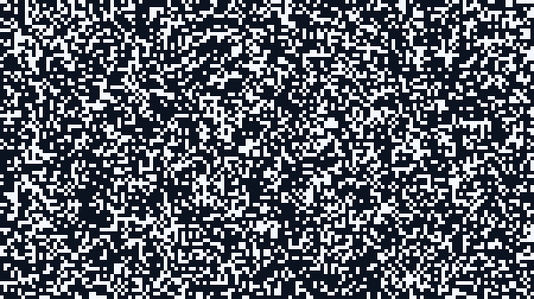
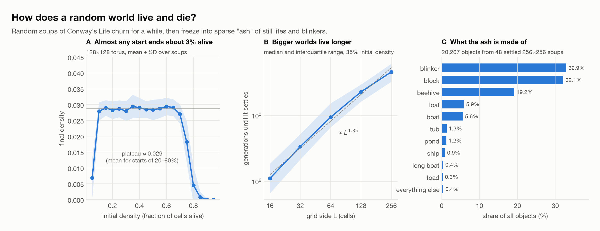
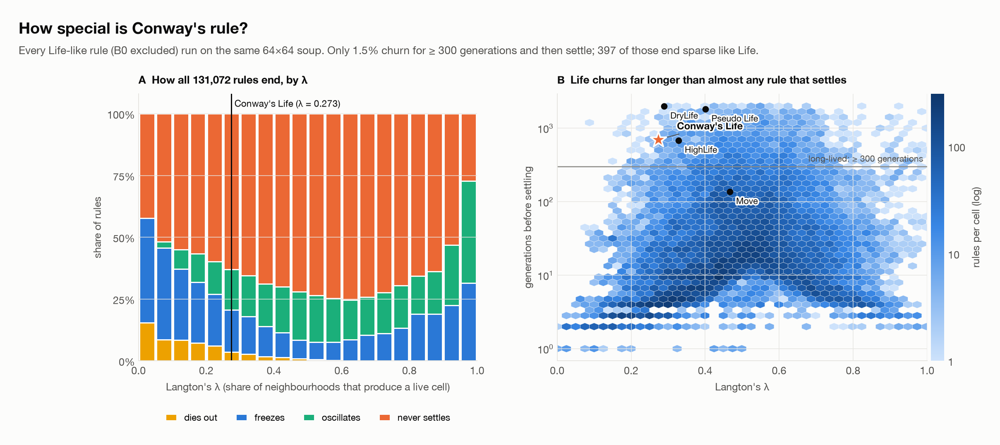
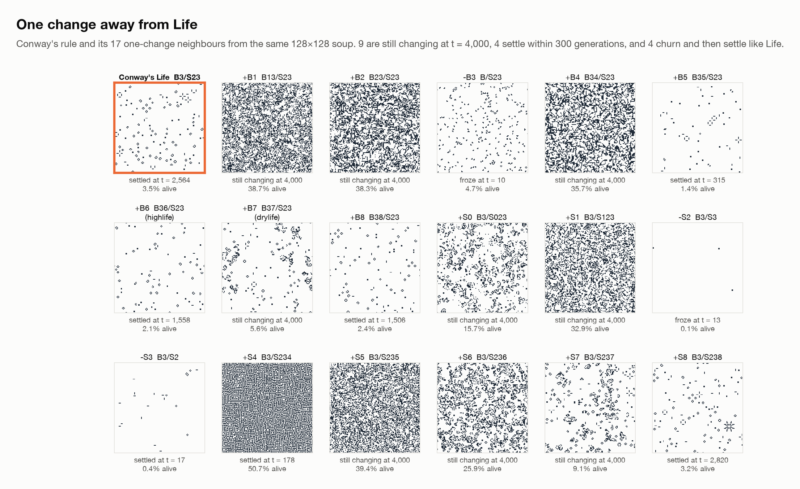
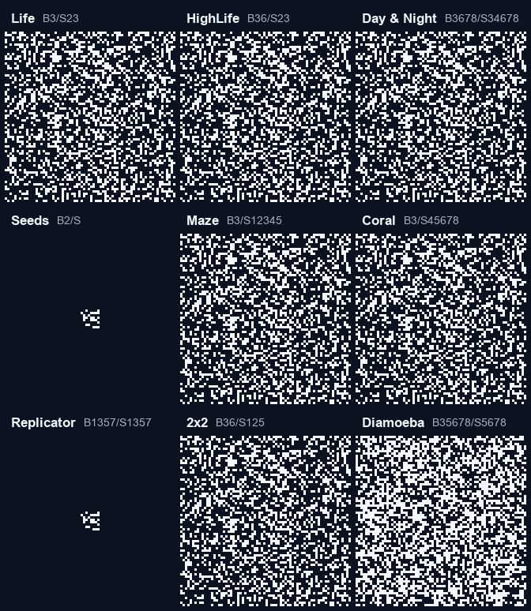
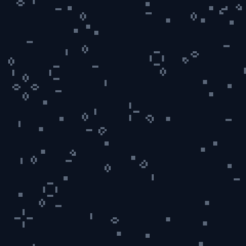
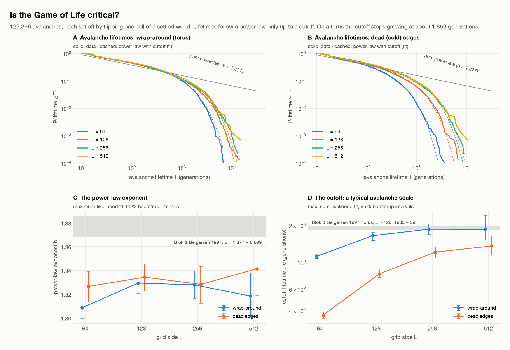
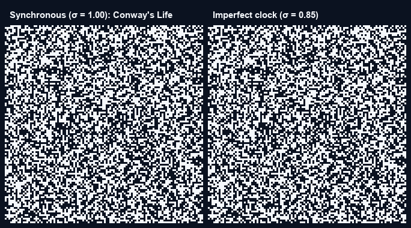
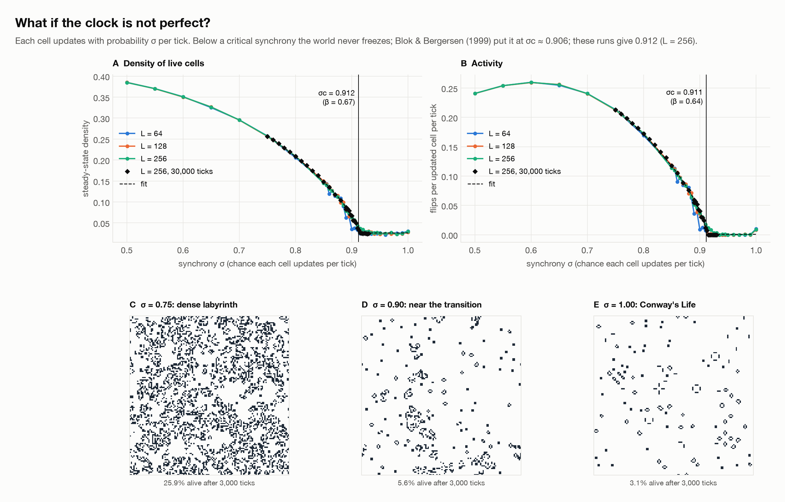

# Is the Game of Life special?

<p align="center"></p>

Conway's Game of Life is one rule out of 262,144 possible "Life-like" rules. This repository is a small,
tested simulator (`lifelab`) and four reproducible experiments that ask what makes that one rule
interesting:

1. **How does a random world live and die?** Lifetimes, leftover density, and a census of the "ash".
2. **How special is Conway's rule?** All 131,072 Life-like rules run on the same soup.
3. **Is Life critical?** A replication of the self-organised-criticality avalanche experiments.
4. **What if the clock is imperfect?** The phase transition in asynchronous Life.

**Interactive version:** [www.mindemory.io/game_of_life](https://www.mindemory.io/game_of_life/) lets you
play with the rules, draw patterns, trigger avalanches and turn down the synchrony in the browser. The page
lives in [`docs/`](docs/index.html).

The project started in 2023 as a pygame toy that drew every live cell as a skull. That version is kept in
[`classic/`](classic/), and `lifelab play --skulls` still draws them.

---

## Findings

### 1. Random worlds burn out into sparse ash



A random soup churns for a while and then freezes into still lifes and blinkers. Starting densities from
10% to 70% all end at nearly the same place, **2.9% of cells alive**. The time to settle grows with
the size of the world (median **2,280 generations** on a 128×128 torus, growing roughly as
L<sup>1.35</sup>). Blinkers (33%), blocks (32%) and beehives (19%) make up 84% of the objects left behind.

### 2. Conway's rule sits in a thin band between frozen and chaotic



Every Life-like rule without B0 (131,072 rules) was run on the same 64×64 soup for up to 2,000
generations. **70%** never settle, and most of the rest freeze or start repeating within a few dozen
generations. Only **1.5% (2,003 rules)** churn for 300+ generations and then settle the way Life does. Conway's rule
settles after **697 generations**, longer than 98% of the rules that settle at all. Its Langton λ is
140/512 ≈ 0.273.



Of the 17 rules one change away, 9 are still changing after 4,000 generations (7 of them dense and
chaotic) and 4 settle within 300 generations. Only 4 (adding B5, B6, B8 or S8) churn and then settle into sparse
ash like Life. Adding B6 gives HighLife, known for its self-copying replicator.

<p align="center"></p>

### 3. Life is near-critical, not critical

<p align="center"></p>

Bak, Chen & Creutz (1989) proposed that Life organises itself into a critical state. Flip one cell of a
settled world and the disturbance (an avalanche) can be any size. This repository repeats the experiment with
**about 130,000 avalanches** on 64² to 512² grids, using both wrap-around and dead edges.



Lifetimes follow a power law with exponent **b ≈ 1.33** (Blok & Bergersen 1997 report 1.377 ± 0.009), but only
up to a cutoff. On a torus the cutoff stops growing once the grid is 256 wide, at **t<sub>c</sub> ≈ 1,860
generations** (Blok & Bergersen: 1,905 ± 59). A finite characteristic scale means Life is *near*-critical, in
line with Bennett & Bourzutschky (1991). With dead edges the cutoff is smaller, because avalanches leak out
of the grid, and still growing at L = 512.

### 4. Below ~91% synchrony, Life stops freezing

<p align="center"></p>

If each cell updates only with probability σ per tick, Life goes through a sharp phase transition (Blok &
Bergersen 1999). Below a critical synchrony it no longer freezes and becomes a dense, ever-changing labyrinth.



The fitted critical point is **σ<sub>c</sub> = 0.912** on a 256×256 torus (published: 0.9083 ± 0.0010 at 128×128,
0.9060 ± 0.0004 extrapolated to infinite size). The frozen density above the transition is 0.026 (published
0.026 ± 0.001). Our estimate sits about 0.005 above the published value. It moved down when the runs near the
transition were lengthened from 8,000 to 30,000 ticks (0.913 → 0.912), so the remaining gap is plausibly
slow relaxation right at the critical point. The fitted exponent is β ≈ 0.67 (published ≈ 0.6). Ordinary Life (σ = 1) sits just on the frozen side of
this transition, which is a natural explanation for why it looks almost, but not quite, critical.

---

## Quick start

```bash
git clone https://github.com/mindemory/game_of_life.git
cd game_of_life
conda env create -f environment.yml      # or: pip install -e ".[viewer,dev]"
conda activate gameoflife
```

```bash
lifelab play                                   # interactive window (pygame); press h for keys
lifelab play --rule highlife --size 200x120
lifelab play --skulls                          # the 2023 look
lifelab render --pattern gosper --size 120x70 --steps 300 --out gun.gif
lifelab render --density 0.35 --size 200 --steps 600 --out soup.mp4 --fps 30   # needs ffmpeg
lifelab census --size 256 --seed 1             # settle a soup and count the objects
lifelab rule B36/S23                           # describe a rule and its one-change neighbours
```

From Python:

```python
import numpy as np
from lifelab import Life, Rule, census, find_cycle, place

world = Life.random((128, 128), density=0.35, seed=1)        # Conway's rule on a torus
world.step(500)
print(world)                                                   # Life(128x128, rule=B3/S23, ...)

cycle = find_cycle(world.grid)                                 # run until a state repeats
print(cycle.transient, cycle.period)
print(census(cycle.grid).most_common(5))                       # [('block', ...), ('blinker', ...), ...]

gun = place(np.zeros((60, 90), np.uint8), "gosper", 2, 2)
highlife = Life(gun, rule="B36/S23", boundary="dead")
print(Rule.parse("B36/S23").langton_lambda)
```

## Reproducing the experiments

The four experiment scripts save their numbers to `results/` and their figures to `figures/`, and `--plot`
redraws a figure from saved results. For a tiny test run, use `--quick`, or `--sample 2000` for
`rule_space.py`, which surveys 2,000 random rules instead of all of them. Times are for an 8-core laptop.

| Script | Question | Time |
| --- | --- | --- |
| `python experiments/soups.py` | random soups: lifetimes, density, census | ~1 min |
| `python experiments/rule_space.py` | all 131,072 rules + Life's mutants | ~15 min |
| `python experiments/avalanches.py` | ~130,000 avalanches, 64² to 512² | ~10 min |
| `python experiments/asynchrony.py` | synchrony sweep, 3 grid sizes (`--refine`: long runs near σc) | ~3 min (+4) |
| `python experiments/make_media.py` | GIFs, clips and the explainer video | ~2 min |

Set `LIFELAB_WORKERS` to control the number of processes.

## How it works

- **Engine** (`lifelab/engine.py`): neighbour counts are two separable 3-sums on a padded array, and the rule
  is a 32-entry lookup table indexed by `(state << 4) | count`. Everything works on stacks of grids, so
  hundreds of worlds (even with different rules) advance in one NumPy call. A 256×256 generation takes
  about 0.15 ms.
- **Exact settling** (`lifelab/analysis.py`): runs are hashed generation by generation, so "settled" means a
  state repeated exactly. This gives the exact transient length and period, gliders orbiting a torus included.
- **Census**: settled grids are split into objects (cells within two squares of each other), and each object is
  simulated alone, then named by comparing its shape across all phases, rotations and reflections with a
  pattern library.
- **Tests** (`tests/`, run with `pytest`): the engine is checked against a slow reference implementation for
  several rules and both boundaries. They also cover known facts about patterns: oscillator periods, spaceship
  speeds, diehard dying at generation 130, and the Gosper gun emitting a glider every 30 generations.

```
lifelab/        simulator package (engine, rules, patterns, analysis, render, viewer, cli)
experiments/    one script per question, plus plotting and media
results/        saved numbers behind every figure
figures/        figures used here and on the project page
media/          local MP4 renders (not tracked; make_media.py)
docs/           the interactive project page (GitHub Pages)
tests/          pytest suite
classic/        the original 2023 pygame version
```

## References

- M. Gardner (1970). Mathematical Games: The fantastic combinations of John Conway's new solitaire game "life". *Scientific American* 223(4), 120–123.
- P. Bak, K. Chen & M. Creutz (1989). Self-organized criticality in the "Game of Life". *Nature* 342, 780–782.
- C. Bennett & M. S. Bourzutschky (1991). "Life" not critical? *Nature* 350, 468.
- F. Bagnoli, R. Rechtman & S. Ruffo (1991). Some facts of life. *Physica A* 171, 249–264.
- H. J. Blok & B. Bergersen (1997). Effect of boundary conditions on scaling in the "game of Life". *Physical Review E* 55, 6249.
- H. J. Blok & B. Bergersen (1999). Synchronous versus asynchronous updating in the "game of Life". *Physical Review E* 59, 3876.
- C. G. Langton (1990). Computation at the edge of chaos. *Physica D* 42, 12–37.
- D. Eppstein (2010). Growth and decay in Life-like cellular automata. In *Game of Life Cellular Automata* (A. Adamatzky, ed.), Springer, 71–98.
- N. Fatès (2010). Does Life resist asynchrony? In *Game of Life Cellular Automata* (A. Adamatzky, ed.), Springer, 257–274.

## License

MIT. See [LICENSE](LICENSE).
